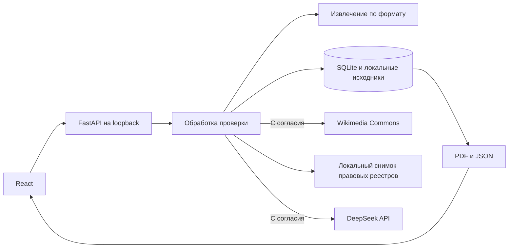

# Архитектура TraceMuse

React и TypeScript образуют интерфейс рабочего кабинета. Vite собирает его в `frontend/dist`. В режиме разработки Vite проксирует `/api`, а в обычном запуске HTML и статические ресурсы обслуживает тот же FastAPI, что и API.

Запрос multipart допускает до десяти файлов и общий предел размера. Backend записывает входной поток небольшими блоками, параллельно вычисляет SHA-256 и обрабатывает содержимое по формату. HTML и SVG читаются как данные. У файлов в ZIP проверяются имена, размеры и лимиты распаковки. Встроенные изображения фиксируются в перечне ресурсов с хешами и доступными свойствами.

Для завершённой проверки SQLite хранит JSON результата, статус, время, SHA-256, размер и внутренний идентификатор сохранённого оригинала. Оригиналы помещаются в отдельный каталог со случайными именами. При повторе берётся копия оригинала. При удалении исходный файл снимается с учёта вместе с записью. Существующая таблица проверок мигрирует с сохранением старых записей.

Поиск с согласием обращается к API Commons. Материал, автор и условия каталога сохраняются как свидетельства, которые можно сверить. Правовой блок может искать совпадения по локальному снимку с датой и официальным адресом выгрузки. DeepSeek обрабатывает ограниченные выдержки и ссылки на собранные доказательства. Отчёты строятся из сохранённого результата.

Основные библиотеки: FastAPI и Starlette, pypdf, Pillow, defusedxml, httpx, ReportLab, React и Vite. Шрифт PDF поставляется вместе с исходниками. Контракт API доступен в Swagger UI по пути `/docs`.
